# Mesh Viewer

A C++ OpenGL mesh viewer with Blinn-Phong, PBR Basic, and PBR Metallic shading, texture workflows, and environment-map lighting (OpenEXR).

## Features

- OBJ mesh loading and in-app mesh upload.
- Texture set workflow (`diffuse/normal/glossiness/specular`).
- Rendering modes:
	- Blinn-Phong
	- PBR Basic
	- PBR Metallic
- Environment map lighting with EXR support.
- GUI controls for camera/light/material parameters.
- CPU-side AO baking integrated into shading.

## Dependencies

This project uses:

- C++14
- CMake (>= 3.5)
- OpenGL 3.3 Core Profile
- GLFW (via vendored NanoGUI submodule tree)
- NanoGUI (vendored in `lib/nanogui`)
- Eigen
- SOIL (vendored in `lib/soil`)
- OpenEXR (`ImfRgbaFile` / `IlmImf`)
- macOS Cocoa/Carbon frameworks (for current desktop build + file dialog)

## Install (macOS)

Install required system packages:

```bash
brew install cmake eigen openexr
```

Build:

```bash
cmake -S . -B build
cmake --build build -j4
```

Run:

```bash
./build/mesh-viewer
```

## Project Libraries

- `lib/nanogui`: GUI system and OpenGL helpers.
- `lib/soil`: image loading for texture maps.
- `Eigen`: matrix/vector math.
- `OpenEXR`: HDR environment map loading.

## Usage

### Mouse / Camera

- Mouse wheel: zoom camera in/out.
- Right mouse drag: rotate model.
- `Shift + Right mouse drag`: orbit camera around scene center.
- `Shift + drag` (without right button mode): move light position in camera plane.

### GUI Panels

- `Render Options`: switch between Blinn-Phong / PBR Basic / PBR Metallic.
- `Textures`: pick texture set or color workflow.
- `Assets`: choose/delete mesh, open new OBJ.
- `Light` popup:
	- `Env. Map`: choose/open/delete EXR environment maps.
	- `Light`: point-light intensity and XYZ controls.

### Interface Overview

#### Main UI Overview

The base UI layout with default controls and environment-enabled shading:

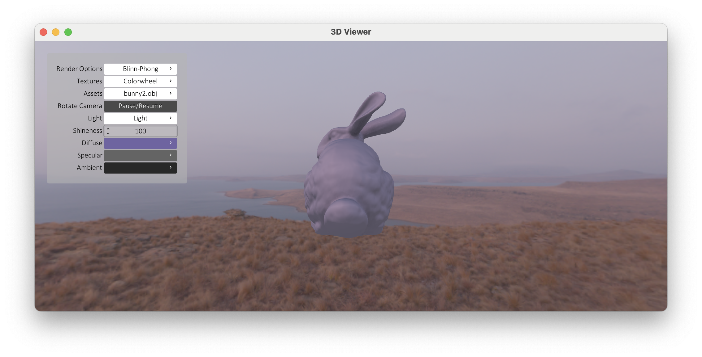

### Render Options

#### Render Mode Switcher (Blinn / PBR Basic / PBR Metallic)

The `Render Options` submenu for switching shading models:

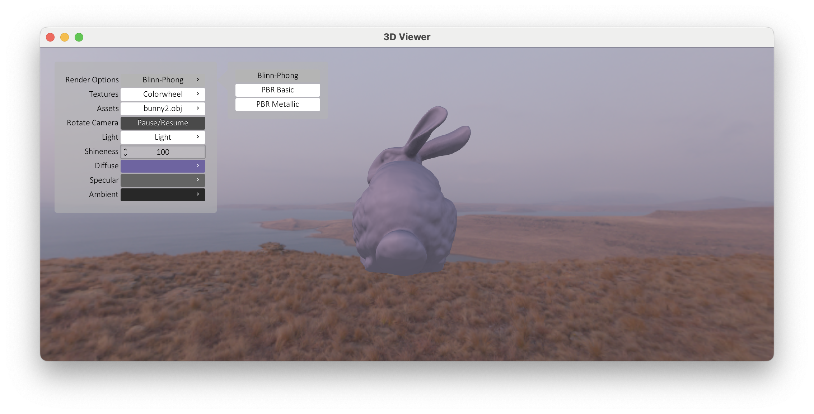

### Texture Workflow

#### Texture Workflow Entry

The `Textures` menu supports colorwheel mode and texture-set mode:

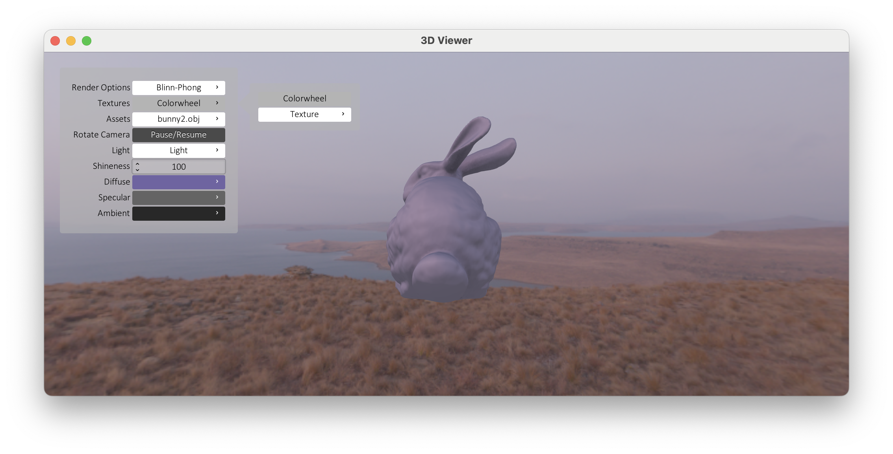


### Asset Workflow

#### Asset Management (OBJ List / Delete / Open)

`Assets` supports list selection, remove (`x`), and loading new models:

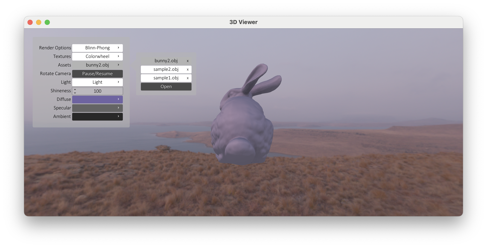

### Lighting Workflow

#### Light Submenu Structure (Environment Map + Point Light)

`Light` is organized into environment map selection and point-light parameter controls:

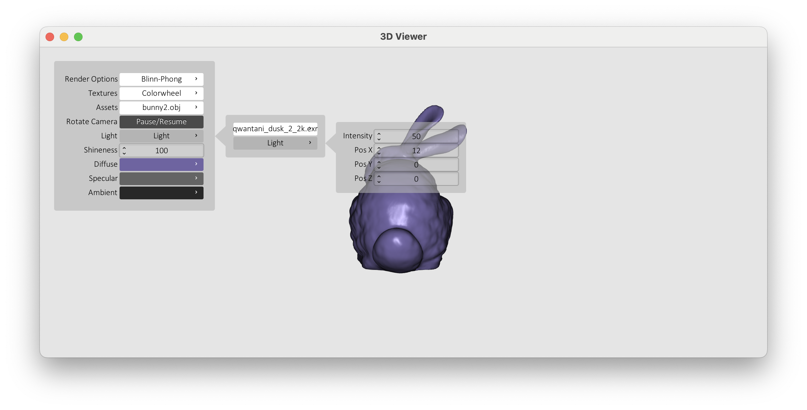
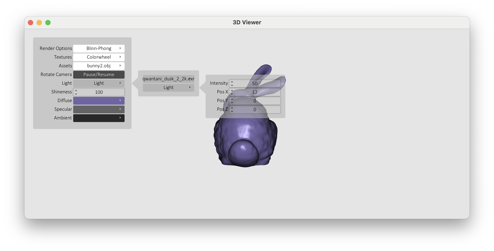

Environment-map switching changes global image-based lighting immediately:

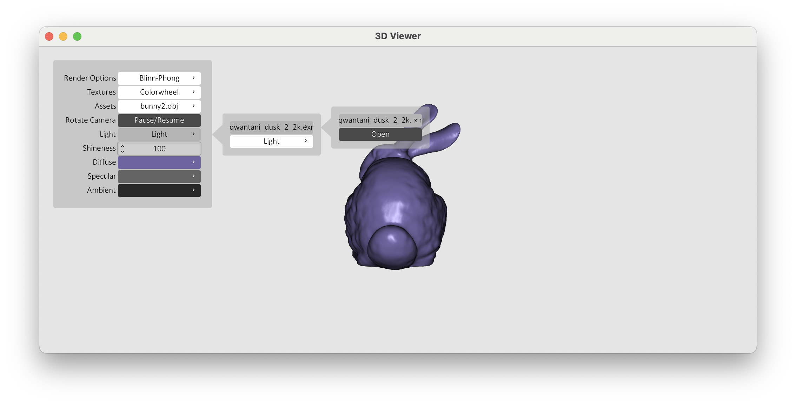
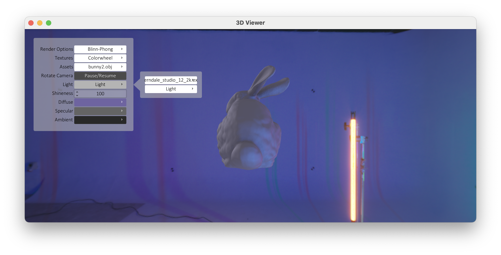

#### Texture Library Management

Texture presets can be listed, removed, and loaded from disk:

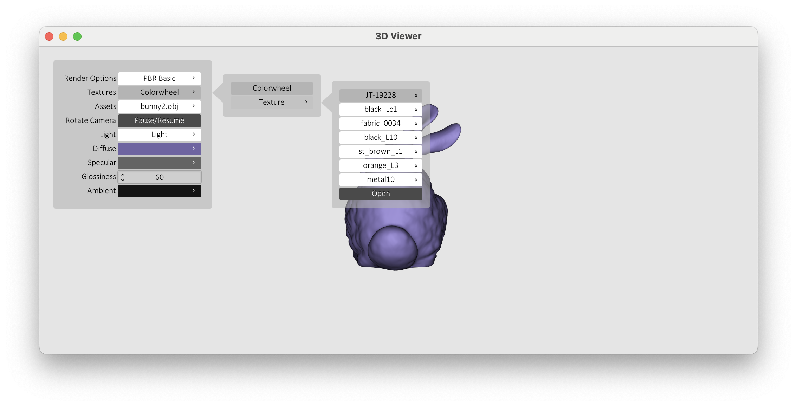

### Material Presets (PBR Basic)

#### Material Preset Results

Examples of different texture/material presets on the same model:

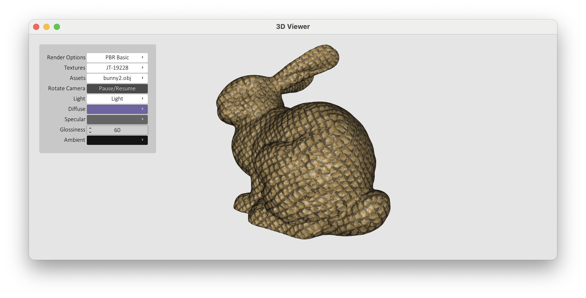
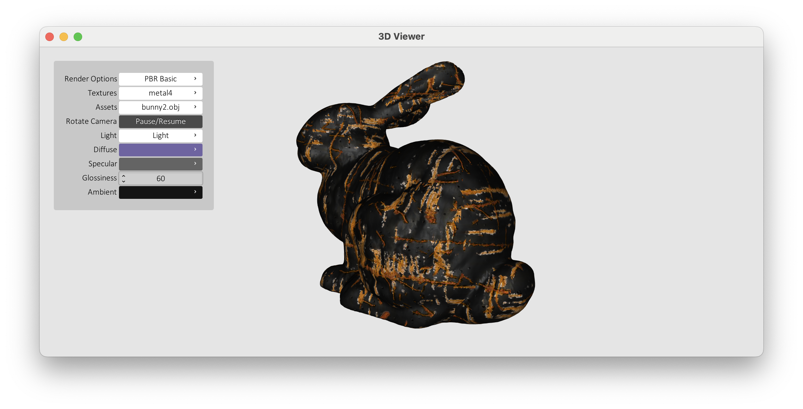
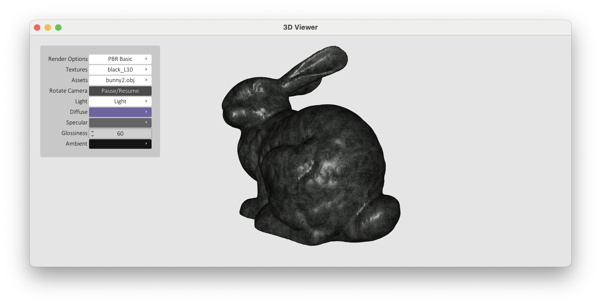

### Environment And Material Interaction

#### Environment + Material Interaction

The same material under different environment maps produces very different reflections and color response:

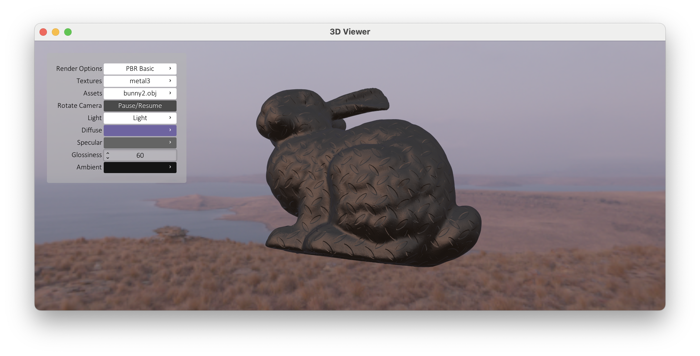
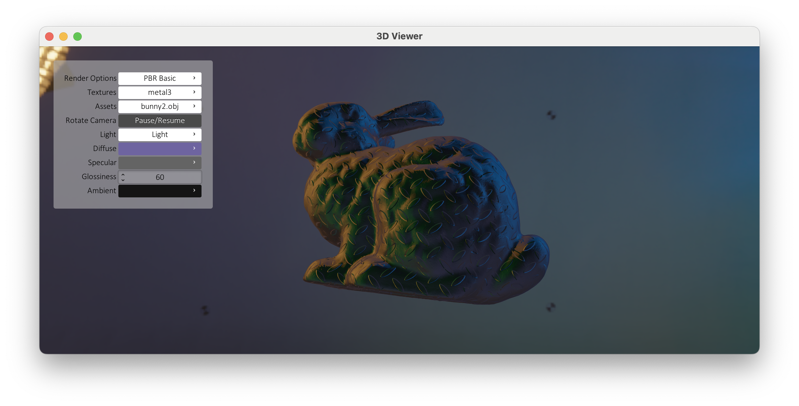

### Multi-Mesh Support

#### Different Mesh With Same Pipeline

A different model (`sample2.obj`) under the same rendering/texture pipeline:

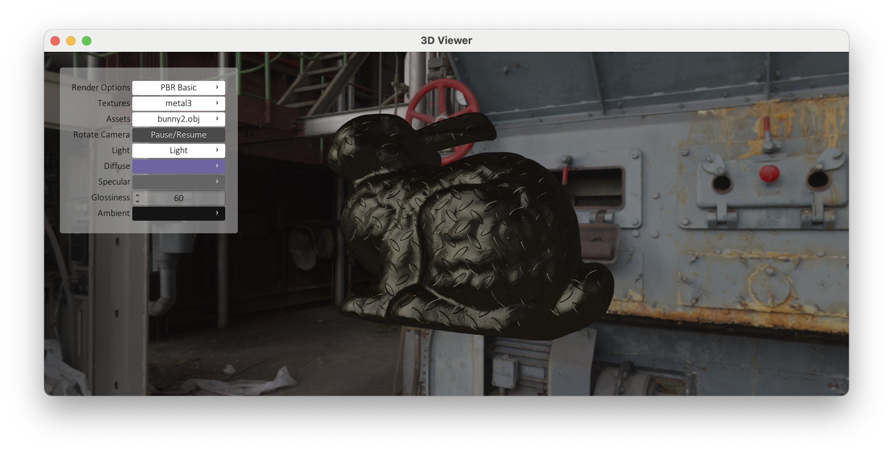
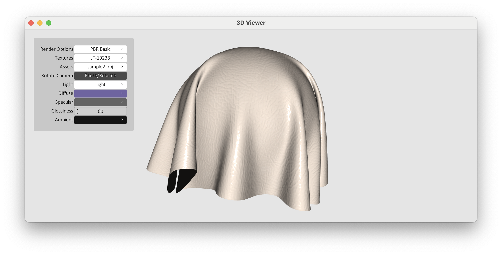

### Texture Folder Format

Each texture set directory should include:

- `diffuse.png`
- `normal.png`
- `glossiness.png`
- `specular.png`

## Automatic Screenshot Capture (macOS)

An automation script is included:

- Script: `scripts/capture_screenshots.sh`
- Output: `docs/screenshots/`

Make executable once:

```bash
chmod +x scripts/capture_screenshots.sh
```

Capture 3 screenshots from the `mesh-viewer` window:

```bash
./scripts/capture_screenshots.sh
```

Useful options:

```bash
./scripts/capture_screenshots.sh --count 5 --interval 2
./scripts/capture_screenshots.sh --output-dir docs/screenshots
./scripts/capture_screenshots.sh --no-launch
./scripts/capture_screenshots.sh --manual
```

Notes:

- The script captures the app window bounds via AppleScript (`System Events`) and uses `screencapture`.
- If Accessibility permission is denied, the script automatically falls back to manual window picking mode.
- On first run, macOS may ask for Accessibility permission for your terminal app.

## Troubleshooting

- Build error about OpenEXR headers/library:
	- Ensure `brew install openexr` completed.
- App launches but textures look wrong:
	- Check texture folder contains the 4 expected files listed above.
- No environment lighting effect:
	- Confirm an EXR is selected under `Light -> Env. Map` and environment mode is active.
- Error `osascript is not allowed assistive access (-25211)`:
	- Enable your terminal in System Settings -> Privacy & Security -> Accessibility.
	- Or run manual mode: `./scripts/capture_screenshots.sh --manual`